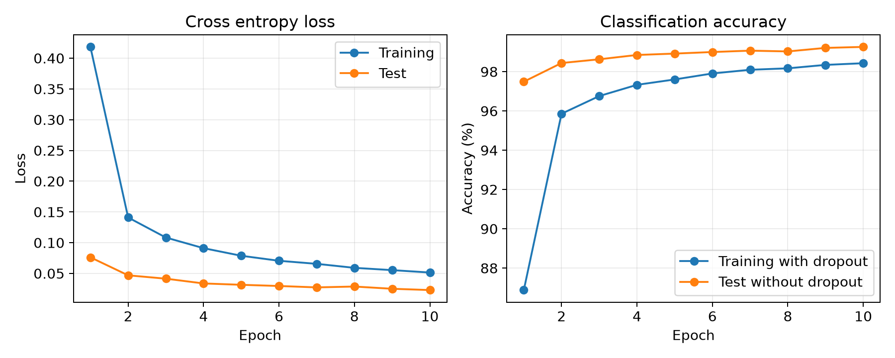
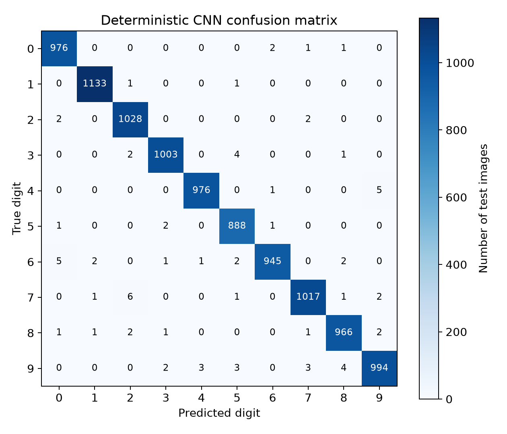
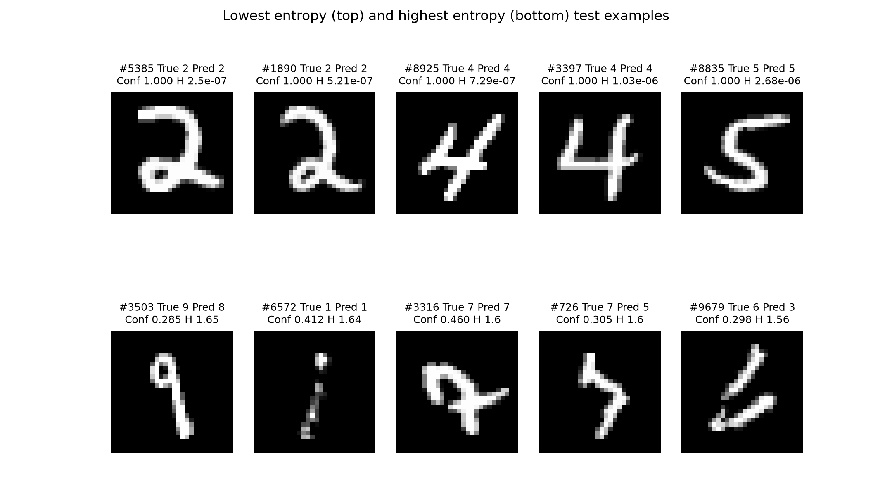
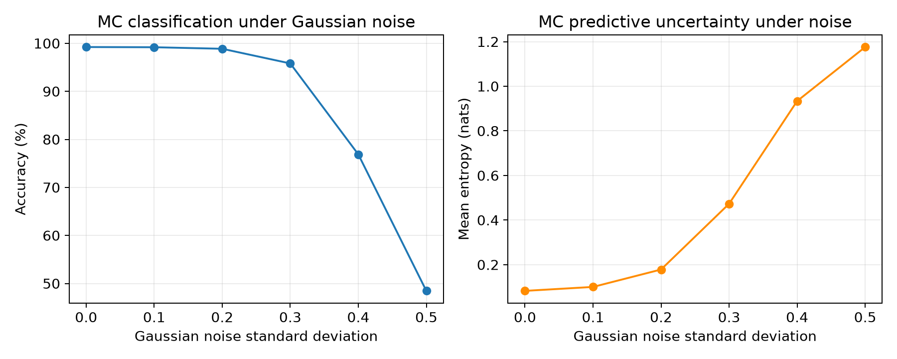

# MNIST Classification and Uncertainty with Monte Carlo Dropout

CISC3024 Pattern Recognition

AI Assignment #2

Student Name: Withheld in public version

Student Number: Withheld in public version

This report studies handwritten digit classification and predictive uncertainty using a small CNN with Monte Carlo Dropout. The deterministic clean test accuracy was 99.2600%; the MC accuracy was 99.2200%. The experiments compare clean images with Gaussian noise and discuss the limitations of the measurements.

# 1 How AI finds the algorithm

The algorithm and MNIST dataset were specified in the student's supplied project brief. The AI assistant did not independently choose the algorithm. It verified the original MC Dropout paper and translated the proposed approach into an executable experiment. The paper provides the theoretical basis for relating dropout to approximate Bayesian inference.

# 2 Algorithm Description

## Bayes theorem and neural networks

Bayes theorem updates a belief after observing data: P(w|D) = P(D|w)P(w) / P(D).
Here w denotes the neural network parameters and D is the training data. The prior P(w) describes beliefs before observing data. The likelihood P(D|w) describes how well the parameters explain the data. The posterior P(w|D) describes beliefs after observing the data.

A conventional neural network uses one fitted set of parameters. A Bayesian neural network instead represents uncertainty through a distribution over parameters. Its predictive distribution is P(y|x,D) = integral P(y|x,w)P(w|D) dw. This integral is usually too difficult to compute exactly for a deep network.

## Monte Carlo Dropout

Gal and Ghahramani (2016) connect dropout training to approximate Bayesian inference under specific modelling assumptions. This project uses a CNN with dropout as a practical approximation, rather than computing an exact posterior over all weights. Dropout remains active during inference, creating a different random mask on each forward pass. The predictive probability is approximated by p_bar = (1/T) sum_t p_t with T = 30.

The predicted class is argmax(p_bar), and confidence is max(p_bar). The class-wise predictive variance is (1/T) sum_t (p_t - p_bar)^2. A scalar variance summary averages these ten class-wise variances. Predictive entropy is H(p_bar) = -sum_k p_bar_k log(p_bar_k), using natural logarithms, so values are in nats and range from 0 to ln(10).

Low entropy indicates concentrated class probabilities; high entropy indicates a more ambiguous predictive distribution. Entropy reflects total predictive uncertainty and is not a pure measure of epistemic uncertainty. The variance measures disagreement across dropout predictions. Neither quantity guarantees calibrated confidence or reliable detection of every out-of-distribution input.

Uncertainty matters in pattern recognition because an application can flag ambiguous predictions for review instead of treating every classification as equally reliable. This experiment measures the behaviour of one approximation and does not establish suitability for safety-critical decisions.

# 3 How AI implements the algorithm

The AI assistant created the project code and implemented the small PyTorch CNN. After an initial D drive GPU environment attempt was stopped at the student's request, the experiment used the existing CPU PyTorch installation. Training uses cross entropy and Adam. The best checkpoint is reloaded before evaluation. Standard inference calls eval(), and MC inference activates only dropout modules while preserving the original module states afterwards.

The pipeline downloads MNIST to the project data directory, records training history, evaluates deterministic classification, scans test images with MC Dropout, ranks uncertainty examples, and repeats MC evaluation for six noise levels. Numeric CSV and JSON outputs are the source for the report. The program uses bounded batches to limit memory use.

# 4 Experiment Settings and Results

## Experiment settings

| Setting | Value |
| --- | --- |
| Python | 3.12.4 |
| PyTorch | 2.14.0+cpu |
| Torchvision | 0.29.0+cpu |
| Operating system | Windows-11-10.0.26200-SP0 |
| Compute device | cpu |
| CUDA available | False |
| GPU used | None |
| Dataset and samples | MNIST; 60000 train / 10000 test |
| Epochs and batch size | 10 epochs; batch size 128 |
| Optimizer and learning rate | Adam; learning rate 0.001 |
| Loss | CrossEntropyLoss |
| Random seed | 42 |
| Dropout rates | Convolution 0.25; fully connected 0.5 |
| MC samples | 30 |
| Input preprocessing | ToTensor only; pixels in [0,1] |
| CPU threads | 4 |
| Selected checkpoint epoch | 10 |

Pixels remain in [0,1]. Noise is added before clipping to [0,1]. All six noise levels use all 10,000 test images and 30 MC passes. A fixed noise generator is independent of dropout sampling, and the same underlying noise draws are scaled across levels. Only one seed and one noise realization per image are evaluated.

## Training and clean test classification

The best deterministic test accuracy was 99.2600%, reached at epoch 10. The final epoch test loss was 0.023009; the reloaded best checkpoint test loss was 0.023009. Training accuracy is measured with dropout active, whereas test accuracy is measured with dropout disabled, so the curves are not directly equivalent.

| Method | Accuracy | Macro precision | Macro recall | Macro F1 |
| --- | --- | --- | --- | --- |
| Deterministic CNN | 99.2600% | 0.992524 | 0.992541 | 0.992525 |
| MC Dropout | 99.2200% | 0.992100 | 0.992120 | 0.992101 |

Figure 1. Training and test loss and accuracy over all training epochs.

Figure 2. Deterministic predictions on the full MNIST test set. Each cell is an image count.

## MC Dropout and selected examples

On clean test images, mean confidence was 0.977782, mean predictive entropy was 0.082582 nats, and mean class-wise predictive variance was 0.00117026. MC accuracy differed from deterministic accuracy by -0.040 percentage points. Accuracy improvement is not the main objective of MC Dropout.

| Group | Index | True | Predicted | Confidence | Entropy |
| --- | --- | --- | --- | --- | --- |
| Low | 5385 | 2 | 2 | 1.000000 | 2.50316e-07 |
| Low | 1890 | 2 | 2 | 1.000000 | 5.2089e-07 |
| Low | 8925 | 4 | 4 | 1.000000 | 7.29197e-07 |
| Low | 3397 | 4 | 4 | 1.000000 | 1.03491e-06 |
| Low | 8835 | 5 | 5 | 1.000000 | 2.68095e-06 |
| High | 3503 | 9 | 8 | 0.284507 | 1.64688 |
| High | 6572 | 1 | 1 | 0.411596 | 1.64274 |
| High | 3316 | 7 | 7 | 0.460342 | 1.60261 |
| High | 726 | 7 | 5 | 0.304703 | 1.6023 |
| High | 9679 | 6 | 3 | 0.297955 | 1.55788 |

Figure 3. The five lowest entropy images above and the five highest entropy images below, selected from all test images.

There were 0 incorrect predictions in the five lowest entropy examples and 3 in the five highest entropy examples. These are selected extremes, not a representative estimate of the error rate. The visual form of the digits should be interpreted alongside the labels and measured probabilities; image clarity is not independently scored.

The five lowest entropy samples show recognizable 2, 2, 4, 4 and 5 shapes, and all five predictions are correct. The high entropy group includes a faint, disconnected digit 1 (index 6572), an unusual looped digit 7 (index 3316), and a disconnected digit 6 (index 9679). These visible forms suggest possible ambiguity, but clarity was not measured independently.

The highest entropy sample (index 3503) has true label 9 and predicted label 8, with confidence 0.284507. The model also confuses a 7 with a 5 (index 726) and a 6 with a 3 (index 9679). Three of the five high entropy predictions are incorrect, whereas two remain correct. High uncertainty therefore indicates ambiguity, not necessarily an incorrect prediction.

These observations refer to the checkpoint and selected examples generated in this run. They must be reviewed again if the model is retrained. Values in the figures and report tables are rounded for display; the per-image CSV retains full numeric precision.

## Gaussian noise experiment

| Noise SD | MC accuracy | Mean confidence | Mean entropy in nats |
| --- | --- | --- | --- |
| 0.0 | 99.2200% | 0.977782 | 0.082582 |
| 0.1 | 99.1800% | 0.973743 | 0.100240 |
| 0.2 | 98.8600% | 0.954034 | 0.178327 |
| 0.3 | 95.8100% | 0.862818 | 0.473114 |
| 0.4 | 76.8800% | 0.683602 | 0.933644 |
| 0.5 | 48.4600% | 0.581321 | 1.175818 |

Figure 4. MC accuracy and mean predictive entropy under increasing Gaussian noise standard deviation.

From noise SD 0 to 0.5, accuracy changed from 99.2200% to 48.4600%, and mean entropy changed from 0.082582 to 1.175818 nats. Mean entropy was nondecreasing across the measured noise levels. The reported values are retained without imposing an expected trend.

## Limitations

The best checkpoint was selected using test accuracy across 10 epochs. Repeated use of the test set can make the selected accuracy optimistic; an independent validation set should be used in a stronger evaluation. This assignment follows the requested protocol. Only one training seed, one model, and one noise realization per image were tested; no error bars or statistical significance claims are made. Gaussian noise changes the input distribution but does not represent all real handwriting degradation. Confidence calibration and out-of-distribution detection were not separately evaluated.

# 5 What I Have Learnt

Reflection draft for the student to review and confirm.

This experiment illustrates that classification accuracy and predictive uncertainty answer different questions. A model can produce a label while assigning substantial probability to alternative classes. MC Dropout uses repeated predictions to summarize this uncertainty, although it is only an approximation to Bayesian inference.

The measured results show how the predictive distribution changes when the input is degraded. Entropy should be interpreted together with prediction correctness and confidence rather than treated as a guarantee of reliability. The evaluation also illustrates why selecting a checkpoint with test data limits the strength of the final accuracy claim.

AI assistance still requires checking the environment, verifying the mathematical definitions, inspecting real outputs, and documenting limitations. The student should adapt this reflection to their own understanding before submission.

# 6 Source Code Webpage Link

https://github.com/CookieWinnie/AIassignment2

# References

Gal, Y. and Ghahramani, Z. (2016). Dropout as a Bayesian Approximation: Representing Model Uncertainty in Deep Learning. Proceedings of ICML, PMLR 48, 1050-1059. https://proceedings.mlr.press/v48/gal16.html

PyTorch. Previous PyTorch Versions. https://pytorch.org/get-started/previous-versions/

NVIDIA. CUDA Toolkit 12.4 Release Notes. https://docs.nvidia.com/cuda/archive/12.4.0/cuda-toolkit-release-notes/index.html
